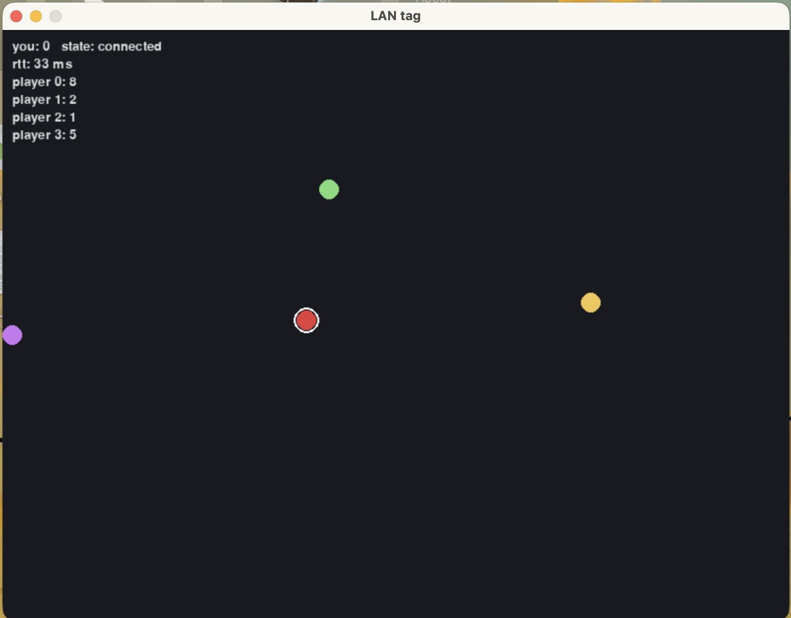

# lan-party

A multiplayer tag game for LAN play. A C networking library and a C++ server run the game over UDP and keep 2-8 players in sync at 30 Hz. Play stays smooth when packets are lost, and players who drop out can rejoin.

<p align="center"></p>

## Installation and Usage

Needs Linux or macOS, CMake 3.16+ and Python 3.10+.

```
cmake -S . -B build && cmake --build build
pip install -r requirements.txt

./build/lanserver                              # server
python client/pygame_client.py --host <ip>     # game window
python client/bot.py --count 3                 # bots to play against
```

Move with the arrow keys or WASD. The red dot is "it": touch someone to tag them and score a point.

## Design

- **Protocol:** each packet has a 13 byte header (protocol id, sequence, ack, 32-bit ack bitfield, type) packed in network byte order. Every packet acks the last 33 received, so either side can tell which of its packets were lost.
- **Delivery:** JOIN, LEAVE, TAG and SCORE are resent until acked and delivered in order. Position input is unreliable, and late packets are dropped.
- **Snapshots:** each tick, a client is sent only the players that changed since the last snapshot it acknowledged. If it's too far behind, it gets a full snapshot.
- **Reconnects:** each player gets a token when they join. If a player is silent for 5 s, they're marked disconnected. They can rejoin with the token within 30 s and keep their position and score.
- **Memory:** no heap allocation in the networking library or the tick loop. Checked with ASan, UBSan and Valgrind.

## Testing

```
python -m pytest                      # ~85 s
sudo USE_NETEM=1 python -m pytest tests/test_lossy.py   # Linux, real tc netem
```

The tests run the real server against Python bots. They cover joins, reconnects, duplicate players, junk packets, and play at 1/5/10% packet loss. Without root, loss comes from a small UDP proxy (`tools/proxy.py`).

## Performance

From `python tools/bench.py`, on localhost:

|                                |                                               |
| ------------------------------ | --------------------------------------------- |
| Bandwidth, 8 players, 2 moving | 989 B/s per player (delta) vs 2120 B/s (full) |
| Drift at 10% loss, 20 ms delay | 4 px median, 22 px max                        |
| Rejoin after a 6 s outage      | 89 ms average                                 |
| Tick time with 32 players      | 0.17 ms (budget is 33 ms)                     |
